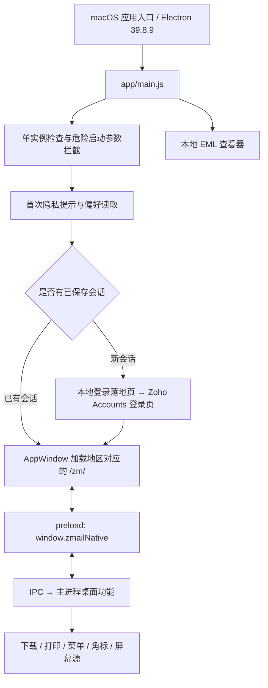

# Zoho Mail Desktop 1.10.5 安装包分析

分析日期：2026-10-19。对象仅为用户提供的 ARM64 PKG；采用 REA 与 macOS 本地静态检查。未安装、启动或修改应用，未访问用户邮箱、现有应用数据或远端服务。附件 `REA_All_Prompts.md` 仅作为参考资料，没有把其中的安装、运行指令视为用户授权。

## 主要结论

这是 **Electron 39.8.9 封装的 Zoho Mail 网页客户端**，带有较完整的桌面集成功能。登录和主要邮件界面从 Zoho 服务加载，安装包交付的 JavaScript 负责窗口、账号会话、下载、打印、菜单和系统接口。因此，可以从包内直接研究桌面层实现，但无法仅凭该包还原服务端或当前在线邮件网页的全部代码与行为。

包签名、公证状态和解包后应用的深度代码签名检查均通过。另有三处原生模块与 ASAR 内部声明哈希不一致，已保留原始证据；这不等于应用代码签名失效，也不能据此断言遭到篡改。

## 1. 文件身份与安装行为

| 项目 | 静态检查结果 |
| --- | --- |
| 安装包 | `zoho-mail-desktop-lite-installer-arm64-v1.10.5.pkg` |
| 文件大小 | 120,653,858 字节 |
| PKG SHA-256 | `3e24a6a0fcbe335c182451bb28c1712fb4b9ef26909efaf2e83442ee8bb2a94b` |
| 应用名称 / Bundle ID | `Zoho Mail - Desktop` / `com.zoho.mail.desktop` |
| 应用版本 | `1.10.5` |
| 主程序架构 | Mach-O ARM64 |
| 系统要求 | macOS 12.0 或更高 |
| 声明安装位置 | `/Applications/Zoho Mail - Desktop.app` |
| 安装权限 | PackageInfo 声明 `auth="root"` |
| 安装载荷 | 一个应用包；声明 877 个文件项、284,588 KiB |
| 安装脚本 | 展开的组件包未见 Scripts；Distribution 为 `require-scripts="false"`，结尾动作为 none |
| 安装签名 | Developer ID Installer: Zoho Corporation，Team ID `TZ824L8Y37` |
| 签名时间 | 2026-10-05 14:02:39 UTC |
| 公证 | `pkgutil --check-signature` 报告 Apple notary service trusted |
| 应用签名 | Developer ID Application: Zoho Corporation；Hardened Runtime 标志存在；`codesign --verify --deep --strict` 通过 |

这是对本地文件及本机验证结果的记录，不是对发布渠道的独立核验或全面安全认证。证书与验证原文保存在 `native-verification.txt`。

REA 包层证据：`ev_20750988923b919d2c4b41e157d3481b5aa0a3cbe364701fbb3f0035ed6e21c2`。REA 对 PKG 只确认根哈希，子文件由 macOS `pkgutil --expand-full` 解出，不能把它的根级覆盖误写成递归包分析。

## 2. 技术结构和启动链



入口由 `package.json` 的 `main: app/main.js` 明确指定。主进程取得单实例锁、检查启动参数、读取外部配置；ready 后初始化证书处理、设备信任管理和生命周期。首次使用先显示隐私提示，随后恢复保存的账号或打开登录窗口。更新任务在主要启动流程中安排。

包内 `buildProperties` 记录构建环境 Node 24.6.0、npm 11.5.2、node-gyp 11.4.1；这些是构建元数据，不能当成实际 Electron 进程的运行时 Node 版本。

主要实现可直接读取已发布 JavaScript。它们经过压缩，保留了大量模块、类、函数和事件名称；不是恢复出的原始开发仓库，也不包含构建历史。

## 3. 登录、多账号与数据中心

普通登录路径是内嵌浏览器页面和 Chromium Cookie 会话。默认登录地址模板为：

```text
https://accounts.zoho.com/signin?servicename=VirtualOffice&serviceurl=https://mail.zoho.com/zm/&hide_signup=true&hide_secure=true
```

登录窗口在导航到匹配邮件服务 hostname 时发出 `login-success`，应用窗口随后加载 `appConfig.appURL`。账号信息还会通过同一 Session 的 Cookie 和 `X-ZCSRF-TOKEN` 调用 `/api/accounts` 补全；这是包内可见的浏览器会话路径，不能描述为独立 OAuth refresh-token 邮件客户端。

每个账号使用 `persist:session-partitionN` 持久化分区。`session-preferences` 保存账号邮箱、显示名、部署地区、最近使用账号等元数据；应用控制器只维持一个主要邮件窗口，切换账号时关闭旧主窗口并用另一分区建立新窗口。EML、打印、登录等辅助窗口另有生命周期。

地区配置包括默认 zoho、中国、欧洲、印度、日本、澳大利亚、加拿大、沙特、阿联酋、新加坡，另含 premail、localzoho 等配置以及 custom。配置存在不代表相应服务当前可达。中国配置指向 `accounts.zoho.com.cn` 与 `mail.zoho.com.cn`。

macOS 自定义配置可从应用读取的系统偏好和 `/Library/Application Support/Zoho Mail - Desktop/custom-config.json` 合并，支持服务域名、证书策略、DevTools、更新策略、日志级别等字段。这里只检查包内读取逻辑，没有读取本机这些配置。

关键文件：`app/dataCentre/`、`app/window/login-window/`、`app/window/app-window/Controller.js`、`app/sessions/SessionStore.js`、`app/sessions/fetchAccountDetails.js`。

## 4. 桌面功能的具体实现

| 功能 | 包内实现证据 |
| --- | --- |
| 网页与桌面桥接 | 主窗口 preload 用 `contextBridge.exposeInMainWorld("zmailNative", ...)` 暴露 18 个成员；页面注册回调或触发 IPC |
| 未读角标 | 页面通过 `registerForCountUpdate` 传递数量，IPC `set-badge-count` 更新应用角标；含 Windows 叠加图标分支 |
| 写邮件 / mailto | Info.plist 注册 `mailto`；协议处理模块解析地址并把写邮件事件传给网页 |
| 附件下载 | Electron `will-download` 管理下载状态、保存位置、取消及完成通知；默认询问保存位置 |
| 下载安全标记 | macOS 写 `com.apple.quarantine`，并更新系统 QuarantineEventsV2 数据库；Windows 写 Zone.Identifier |
| 打印预览 | 截取网页打印内容，生成 PDF，使用独立窗口预览并调用系统打印；含页码、纸张、打印机等处理 |
| 本地 EML 查看 | 注册 `.eml`，使用 `mailparser.simpleParser` 解析正文、头信息和附件，再送往包内查看页面 |
| 查找、菜单、托盘 | 独立窗口和菜单模块，带快捷键、账号切换、系统托盘偏好 |
| 屏幕共享接入 | preload → `get-desktop-capturer-sources` → 主进程 `desktopCapturer.getSources` |
| 输入历史 | 登录等使用该模块的页面记录符合条件的输入，提供前缀建议；跳过 password、OTP、信用卡类 autocomplete 等 |

**SQLite 的用途需要特别区分**：已经确认的第一方调用位于 `xattrUtil.js`，写入 `~/Library/Preferences/com.apple.LaunchServices.QuarantineEventsV2`，用于下载隔离事件。仅凭依赖 `sqlite3`，不能说应用使用 SQLite 保存邮件正文或维护离线邮箱。

## 5. 本地保存与隐私

| 数据 | 实现及证据边界 |
| --- | --- |
| 应用偏好 | `electron-store`，名称 `app-preferences`，包含窗口、下载、托盘、更新等设置 |
| 账号元数据 | `electron-store`，名称 `session-preferences`；构造参数未指定 encryptionKey，不能与加密 Cookie 混为一谈 |
| 登录会话 | Electron 持久分区 Cookie 和网页存储；REA Fuse 读取显示 CookieEncryption enabled |
| 输入历史 | `input-history` 的 secret 字段为 safeStorage 加密后 Base64；加密不可用时不持久化；每字段最多 25 项、每项 2–200 字符、最多 300 字段 |
| 崩溃数据 | crashReporter 的 `uploadToServer: false`、submitURL 为空；crashDumps 指向应用 userData |
| 下载记录 | 下载管理器以进程内数组保存当前下载信息；是否另有网页持久化行为未确认 |

删除账号的 `clearStorageData` 明确列出 cookies、localstorage、websql、serviceworkers；没有在该调用中列出 indexeddb 或 cachestorage，也没有删除整个持久分区目录。因此，源码支持“清理指定类别和账号元数据”，不支持“彻底抹除所有本地邮件及缓存”的结论。实际遗留范围需要运行前后文件系统对比。

常规 userData 位置预计依 Electron 平台规则形成；本次没有启动应用，故不把推定路径写成已观察事实。

## 6. 安全边界与应复核之处

以下均为静态事实或待验证风险，不是已利用漏洞。

1. **启动调试限制较明确。** `CommandLineGuard` 拦截 inspect、remote-debugging、no-sandbox、disable-web-security、ignore-certificate-errors 等参数。REA 读取 Fuse 得到 RunAsNode disabled、NodeOptions disabled、NodeCliInspectArguments disabled、EmbeddedAsarIntegrityValidation enabled、OnlyLoadAppFromAsar enabled。由此可推导通常的 CLI Inspector 参数不被该构建接受；不能扩展成“任何方式都无法调试”。应用内部 DevTools 策略另有配置，默认允许。
2. **权限检查较宽。** 主 Session 的 `setPermissionCheckHandler(()=>true)` 无条件返回 true；请求处理器对 appDomain 和 baseDomain 的子域直接允许，对其他来源显示询问。这是 Electron 层策略，不代表绕过 macOS 摄像头、麦克风或屏幕录制授权。
3. **IPC 来源值得继续审计。** REA 在所选源码范围未提取到 sender validation；人工核对的 `user-account-details`、屏幕源、下载设置等 handler 未显式校验 sender/origin。主窗口只有一个，不能据此宣称已证实跨账号污染或任意远程代码执行；仍需结合允许的导航、子窗口和桥接暴露条件做受控验证。
4. **证书异常存在例外路径。** 撤销、固定密钥不匹配、结构损坏等错误被列为不可覆盖；其他错误可按管理员主机配置或用户确认放行。`AllowCertificateBypass` 未配置时默认允许弹出确认，用户接受后按 host、证书指纹和错误类型在进程内缓存。`NSAllowsArbitraryLoads` 在 plist 中也存在；这些都不能简化成“所有证书错误都自动忽略”。
5. **Hardened Runtime 有 Electron 所需例外。** 签名 entitlement 包含 allow-jit、allow-unsigned-executable-memory、disable-library-validation，以及音频、摄像头和位置相关项。这些是实际签名权限；Info.plist 中的用途描述与系统授权状态是不同证据。
6. **设备信任路径在 macOS 被平台条件禁用。** 包内有 ManageEngine Agent 查找、TokenInjector 及 `X-MDM-token` 逻辑，但 `NamedPipeTokenRefresher.start()` 在非 win32 直接返回 false。不能因包内含有这些模块就说本 ARM64 macOS 包实际调用了该 Agent。TokenInjector 还会添加 `X-ZM-DESKTOP-APP: v1.10.5`；其异常分支回调为 `cancel:false`，日志中的 blocked 文本不等于请求被实际取消。

## 7. 更新机制

`electron-updater` 的包内配置为 generic provider，基址 `https://downloads.zohocdn.com/zmail-desktop/mac/`，channel 为 `latest-arm64`。应用通过 `artifacts.json` 做网络预检；允许自动更新时启动即检查，此后每 7,200,000 ms（两小时）检查。代码设置 `allowDowngrade=false`，更新下载完成后提示用户，接受后调用 quitAndInstall。外部策略可禁用更新。

这是包内更新配置和调用链，未联网检查当前更新版本，未验证整个更新下载、签名核验与替换流程。

## 8. ASAR 完整性异常

主 `app.asar` SHA-256：`6d284ef0f391b2b880c5c3def78ffbfecd5ed8ce495d4f5460c579c1b3ea6a3a`。

Info.plist 声明的 ASAR header SHA-256 为 `a1f1b8fe3a82cb238aabd1a7352f5e1663368da36c4c9b891dc88885d93b3f5d`，本地对 header 原始 JSON 字节重算一致。它与整个 ASAR 文件哈希的含义不同。

REA 对以下 unpacked native addon 发现内部声明哈希与实际字节不一致：

- `node_modules/fs-xattr/build/Release/xattr.node`
- `node_modules/sqlite3/lib/binding/napi-v6-darwin-unknown-arm64/node_sqlite3.node`
- `node_modules/sqlite3/lib/binding/napi-v6-darwin-unknown-x64/node_sqlite3.node`

第一处声明为 `487c3157674458acb7c645fb457c35564a54e626a577ec12c53265c921e4eee9`，实际为 `1376996f362bbeda6e2e57cc53ad4cdeaa48106788a26d526f8a85b06f60dd11`；其余完整记录见 REA summary 与原始 bundle。

REA 默认拒绝继续，随后使用 `integrity_policy: record-and-continue`，把矛盾及不可信状态保留后分析 JavaScript。原生文件在写入 ASAR 元数据后被签名或处理是可能解释，尚未拿到签名前构件验证原因。应用深度签名验证通过是独立事实，不能消除内部矛盾，也不能单独证明矛盾原因。

## 9. 覆盖范围与证据索引

ASAR 目录共 2,687 个文件项，其中 2,657 个 packed、30 个 unpacked。已保留 packed 文件的提取副本；unpacked 原件在解开的应用包旁。REA 明确选择 134 个第一方源码、配置或 HTML 文件，解析 106 个 JavaScript 文件，未报告解析失败。第三方依赖和大型 EML 前端资源没有进行完整语义分析。

REA 返回 8 个 BrowserWindow 静态构造观察、5 组 contextBridge API、77 个字面 IPC channel、154 个 IPC 操作。它们是分析器识别的语法观察数量，不是运行时同时开启窗口、功能或通道的数量。动态拼接、外部网页、部分 HTML 内联脚本等仍有覆盖限制；图为 partial。

| 调查问题 | 状态 |
| --- | --- |
| 包身份、签名、架构、安装位置 | 已回答，静态检查 |
| 桌面技术栈、入口、登录和账号切换 | 已回答到包内调用路径；运行结果未观察 |
| 下载、EML、打印和桌面桥接 | 已定位实现；未做功能实测 |
| 本地存储和更新策略 | 部分回答；网页存储内容和完整更新执行未观察 |
| 安全边界 | 已记录可见策略；不构成漏洞利用或全面安全审计 |
| 完整邮件网页、服务端、真实网络和离线能力 | 未回答，安装包静态证据不足 |

主要 REA Evidence：

- JavaScript 分析：`ev_343051c2701c1ba26c7d53219fc8aedb1d43a0345a8357de78567eaf30396e61`
- 分析摘要视图：`ev_e3dde17b5a9c5424eb0a1733a31efb249e21c6ec23812f43a11d65e4fd017019`
- Fuse：`ev_0bc22dd29679122dfe9ca055bd6cde86357fbc4fc6d167ffefd6b95dcde5ac1a`
- PKG：`ev_20750988923b919d2c4b41e157d3481b5aa0a3cbe364701fbb3f0035ed6e21c2`

本目录文件：

- `rea-evidence-bundle.json`：完整 REA 会话证据，约 111 MB，含未解析范围和完整性矛盾。
- `rea-analysis-summary.json`：原分析元数据、统计、所选路径、完整性矛盾和局限的精简投影。
- `rea-electron-boundaries.json`：来自原证据的窗口、桥接、IPC 和存储节点投影；自动 endpoint 候选须人工核对，`secret`、`lastOpenedSession` 等 store key 不是真实网络端点。
- `native-verification.txt`：pkgutil 与 codesign 原始检查输出。
- `asar-inventory.json`、`extracted-files-sha256.json`：ASAR 文件项及提取文件身份。
- `asar-extracted/`：原始发布的 packed 文件副本。
- `pkg-expanded/`：完整解包载荷，保留原 ASAR 和 unpacked 文件。

报告中的功能解释同时基于 REA 与对上述提取文件的人工静态核对。没有把文档注释、文件名、未执行代码或自动分析候选当成运行时证据。
